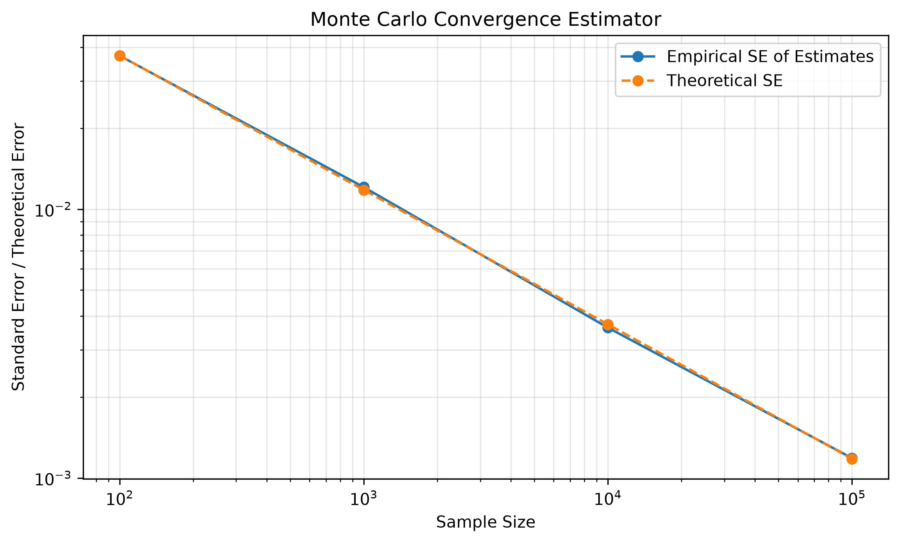
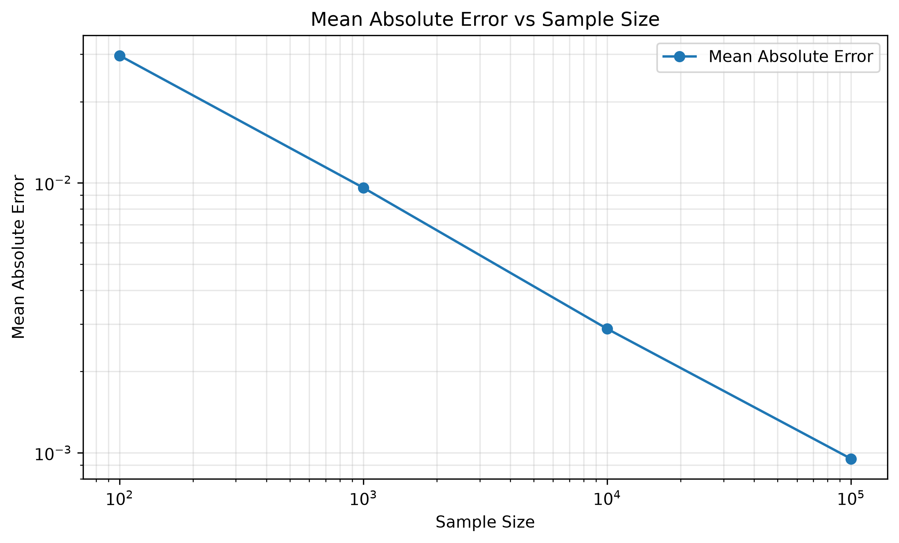

# Monte Carlo Convergence Experiment

## 1. Objective

Investigate how the accuracy of a Monte Carlo probability estimate improves as the number of observations increases.

The experiment estimates the probability of rolling a six with a fair six-sided die, and compares:

- the spread of repeated estimates (empirical standard error) with the theoretical standard error;
- the typical error of a single estimate (mean absolute error) with its theoretical value.

**Main finding:** the error shrinks like $1/\sqrt{n}$. To make the error 10 times smaller, we need 100 times more rolls.

## 2. Mathematical Background

### 2.1 Theoretical Probability

$$
p = \frac{1}{6} \approx 0.166667
$$

### 2.2 Probability Estimator

For $n$ independent die rolls, let $X$ be the number of sixes. The estimator is

$$
\hat p = \frac{X}{n}
$$

Since $X \sim \text{Binomial}(n, p)$:

$$
E[\hat p] = p, \qquad \operatorname{Var}(\hat p) = \frac{p(1-p)}{n}
$$

So $\hat p$ is unbiased for every $n$: on average it is correct, whatever the sample size. What changes with $n$ is how far a single estimate tends to be from $p$.

### 2.3 Standard Error

$$
SE(\hat p) = \sqrt{\frac{p(1-p)}{n}} \propto \frac{1}{\sqrt n}
$$

On a log-log plot this is a straight line with slope $-\tfrac{1}{2}$.

### 2.4 Mean Absolute Error

The typical size of the error of one estimate is

$$
\text{MAE} = E\big[\,|\hat p - p|\,\big]
$$

By the Central Limit Theorem, $\hat p$ is approximately normal for large $n$, which gives

$$
\text{MAE} \approx \sqrt{\frac{2}{\pi}} \cdot SE(\hat p) \approx 0.8 \cdot SE(\hat p)
$$

## 3. Method

| Parameter | Value |
|---|---:|
| True probability | 1/6 |
| Sample sizes $n$ | 100, 1,000, 10,000, 100,000 |
| Repetitions per sample size | 1,000 |
| Total die rolls | 111,100,000 |
| Random seed | 42 |

For each sample size $n$:

1. Roll the die $n$ times and compute $\hat p$.
2. Repeat this 1,000 times independently.
3. From the 1,000 estimates, compute their mean, sample variance, sample standard deviation (the empirical standard error), and mean absolute error $|\hat p - p|$.
4. Compare with the theoretical standard error and theoretical mean absolute error.

## 4. Results

Results from the seeded run (seed 42):

| $n$ | Mean of estimates | Empirical SE | Theoretical SE | Mean $\lvert\text{error}\rvert$ | Theoretical MAE (≈ 0.8 SE) |
|---:|---:|---:|---:|---:|---:|
| 100 | 0.168660 | 0.037189 | 0.037268 | 0.029640 | 0.029735 |
| 1,000 | 0.166765 | 0.012071 | 0.011785 | 0.009590 | 0.009403 |
| 10,000 | 0.166579 | 0.003624 | 0.003727 | 0.002879 | 0.002974 |
| 100,000 | 0.166698 | 0.001185 | 0.001179 | 0.000950 | 0.000940 |

The theoretical MAE column is calculated from the formula in section 2.4.





## 5. Interpretation

### 5.1 Single estimates get closer to $p$

Each time $n$ grows by a factor of 10, the typical error of one estimate falls by about $\sqrt{10} \approx 3.2$: from about 0.030 at $n = 100$ to about 0.00095 at $n = 100{,}000$. This is the Law of Large Numbers in action, with a measured rate.

### 5.2 Simulation matches theory

The empirical standard error and mean absolute error both closely follow their theoretical values, usually within a few percent. On the log-log plots, the lines have slope $-\tfrac{1}{2}$.

Small differences are expected, because each empirical value is calculated from a finite number (1,000) of repetitions.

### 5.3 The mean of the estimates

The mean of the 1,000 estimates is close to 1/6 at every sample size, as expected from $E[\hat p] = p$. It is not a good measure of convergence: it averages many estimates, so it hides how far a single estimate can be from $p$. The useful measures of convergence are the standard error and the mean absolute error.

## 6. Conclusion

The error of a Monte Carlo estimate decreases like $1/\sqrt n$, and the simulation matches this rate closely. The practical consequence is that each extra digit of accuracy costs 100 times more samples. This is the main limitation of plain Monte Carlo methods, and the reason variance-reduction techniques exist.

## 7. Implementation

Code: `examples/probability_projects/monte_carlo_convergence.py`

It reuses MathLab's probability simulation helpers, `sample()`, `empirical_pmf()`, `empirical_mean()` and `sample_variance()`, and input checks from `probability/validation.py`. Matplotlib draws the figures and saves them to `docs/probability_projects/images/`.

**Run it** from the `mathlab` folder:

```
python -m examples.probability_projects.monte_carlo_convergence
```

## 8. Limitations

- Results depend on Python's pseudo-random generator. The fixed seed makes them repeatable, but a different seed gives slightly different numbers.
- Each empirical value comes from 1,000 repetitions, so it is itself an estimate with some uncertainty.
- The die is assumed fair, with a known true probability. Real problems usually have no known answer to compare against.
- The normal approximation behind "MAE ≈ 0.8 SE" is less accurate for small $n$.